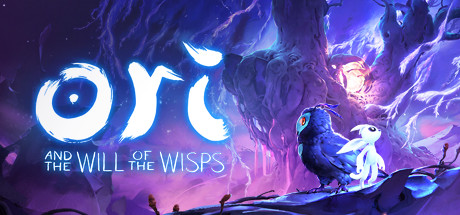

**Ori and the Will of the Wisps is a visually breathtaking Metroidvania sequel with fluid movement, challenging platforming, and an emotional story set in a lush but dangerous forest world. Master dashing, burrowing, and combat arts to save a fragile world from darkness.**

---

## 📖 About

Ori and the Will of the Wisps is a visually breathtaking Metroidvania sequel with fluid movement, challenging platforming, and an emotional story set in a lush but dangerous forest world. Master dashing, burrowing, and combat arts to save a fragile world from darkness.

## ⚠️ Problems Without Trainer

| Problem | Status |
|---------|--------|
| **Brutal Platforming** — Late sections require precise movement with no margin for error | ✅ Solved |
| **Limited Shards** — Shard slots create agonizing ability trade-offs | ✅ Solved |
| **Boss Rush** — End-game boss gauntlet with no checkpoints between fights | ✅ Solved |
| **Resource Scarcity** — Spirit light for upgrades is hard to farm efficiently | ✅ Solved |

## ✅ Solution

The **Ori and the Will of the Wisps Trainer** solves all these issues by giving you complete control over the game.

## 🎯 Full Feature List

- Unlimited Resources
- God Mode / Invincibility
- Instant Skill Cooldown
- One-Hit Kill
- Freeze Game Timer
- Unlock All Items & Achievements
- Custom Speed Multiplier
- Save State Anywhere

## 🚀 Quick Start

1. **Disable Windows Defender** temporarily (trainer may trigger false positive)
2. Download the trainer from the button above
3. Launch Ori and the Will of the Wisps
4. Run the trainer as Administrator
5. Activate desired cheats with hotkeys

## 💎 Free vs Paid

| Feature | Free | Pro |
|---------|------|-----|
| Basic God Mode | ✅ | ✅ |
| Unlimited Resources | ✅ | ✅ |
| All Advanced Cheats | ❌ | ✅ |
| Auto-Updates | ❌ | ✅ |
| Priority Support | ❌ | ✅ |

## 💻 Requirements

- Windows 10/11 (64-bit)
- Ori and the Will of the Wisps (any version)
- .NET Framework 4.8+
- DirectX 11+

## 🍎 macOS

macOS users can use our alternative tool:

## ⚖️ Legal

This trainer is for educational and single-player use only. Use responsibly.

---

